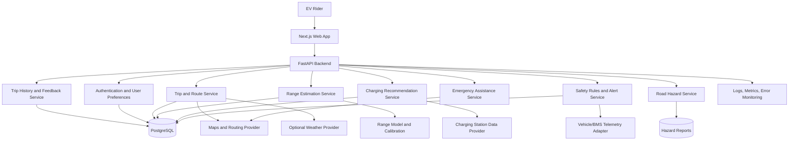

# EV Safety Copilot — System Architecture

**Document type:** Product and technical architecture  
**Status:** Proposed architecture for a hackathon MVP, with a phased path to production  
**Primary users:** E-rickshaw, e-scooter, and e-cycle riders; future secondary users include fleet operators and service partners.

---

## 1. Product Overview

EV Safety Copilot is a safety-oriented journey-planning and decision-support web application for electric-vehicle riders. It combines trip information, battery and vehicle data, GPS, route and charging information, and predictive analysis to help riders make better-informed decisions before a problem becomes critical.

The product is intended to move beyond displaying battery percentage or a nominal range. It should explain whether a journey appears feasible with the available information, identify uncertainty and risk, and recommend a practical next action.

### Core product promise

> Turn available EV, trip, and map data into understandable range estimates, charging recommendations, and preventive safety alerts.

### Important product boundaries

- The application is a decision-support tool, not a guarantee of vehicle safety.
- Predictions must show uncertainty and must not be presented as exact facts.
- Safety-critical battery decisions must follow verified sensor data, manufacturer guidance, and deterministic rules—not an unconstrained LLM response.
- Real-time hazard detection, automatic crash detection, and direct battery-management-system (BMS) integration require compatible hardware, data, and validation. They are not assumed to work for every vehicle.
- The MVP may use manual inputs, recorded trips, or clearly labelled simulated telemetry when live vehicle data is unavailable.

---

## 2. Users and Primary Use Cases

### 2.1 EV rider

- Check current battery information and estimated usable range.
- Enter a destination and evaluate trip feasibility.
- Find a compatible charging station that is reachable with an appropriate reserve.
- Receive warnings when predicted range changes materially.
- Review battery-temperature or vehicle warnings when verified telemetry is available.
- View mapped or reported road hazards.
- Access emergency assistance and share location with a trusted contact.

### 2.2 Fleet operator (future scope)

- Review vehicle status and trip summaries.
- Identify repeated high-consumption trips or recurring vehicle warnings.
- Monitor fleet-level charging needs and vehicle availability.
- Review driver-reported hazards and incidents.

### 2.3 Service or charging partner (future scope)

- Maintain station or service information, including supported connector/vehicle types, operating status, and location.
- Receive a structured service request where an approved integration exists.

---

## 3. Feature Catalogue

Features are divided by delivery phase so the MVP remains achievable and testable.

### 3.1 MVP — build first

#### A. Rider dashboard
- Current battery state of charge (SoC), entered manually or received from an integration.
- Estimated remaining range with an uncertainty interval or confidence label.
- Current location and trip status, when location permission is granted.
- A clear status summary: `OK`, `Caution`, or `Action recommended`.
- Simple, large visual indicators suitable for quick comprehension.
- Last-updated timestamp and data-source indicator (live, manual, recorded, or simulated).

#### B. Smart range prediction
- Estimate usable range from available SoC, vehicle efficiency, recent energy consumption, route conditions, and known load information.
- Update the estimate as new trip or vehicle data becomes available.
- Account for vehicle type and model-specific efficiency where known.
- Display assumptions and uncertainty; avoid presenting a single number as guaranteed.
- Record actual trip outcomes for later evaluation and model improvement.

#### C. Destination reachability
- Accept a destination and calculate a route.
- Estimate the energy required for the route using available distance, elevation, and consumption data.
- Compare expected energy demand with usable energy and a configurable safety reserve.
- Return an understandable result: likely feasible, uncertain, or not recommended with current information.
- Suggest a practical alternative when the destination is too risky to attempt.
- Never claim certainty when the model or inputs are incomplete.

#### D. Charging-station recommendations
- Show nearby stations using a map/search provider or a maintained station dataset.
- Filter by known vehicle/connector compatibility where data exists.
- Estimate whether a station is reachable before recommending it.
- Rank candidates using route feasibility, detour, compatibility, reported availability, and data freshness.
- Label unknown availability or compatibility instead of assuming a station is usable.
- Provide navigation links and a station details view.

#### E. Actionable warnings
- Low estimated range or insufficient energy reserve.
- Significant range reduction compared with the prior estimate.
- Reported hazard along the planned route.
- Verified battery-temperature or BMS warning, if available.
- Missing or stale data that makes the estimate unreliable.
- Each alert should explain: **what was detected, why it matters, confidence/data source, and what action to consider**.

#### F. Trip and event history
- Store trip summaries and predicted-versus-observed consumption where available.
- Record warnings, recommendation outcomes, and user feedback.
- Let users inspect previous trips and range estimates.
- Allow deletion of stored history and location data according to the privacy policy.

#### G. Emergency assistance
- One-tap access to current location.
- Nearby compatible charging or repair options where known.
- Optional sharing of location with a user-selected trusted contact.
- Simple guidance for responding to a vehicle warning, based on verified instructions.
- Clear statement that the app does not replace emergency services or manufacturer guidance.

### 3.2 Phase 2 — after MVP validation

#### A. Battery health and thermal guidance
- Ingest BMS data when a compatible interface exposes it.
- Track available battery temperature, voltage, current, warnings, and capacity estimates.
- Detect unusual trends and recommend inspection when warranted.
- Follow manufacturer-provided charging and operating limits.
- Avoid diagnosing internal battery damage from SoC or GPS alone.

#### B. Load-aware energy estimates
- Accept driver-entered passenger/cargo/load categories.
- Use a weight sensor or vehicle interface if available.
- Adjust energy-consumption estimates using validated relationships.
- Compare measured load with the applicable vehicle limit only when reliable measurements and specifications are available.
- Clearly label inferred load as an estimate; GPS cannot measure load.

#### C. Road-hazard intelligence
- Show user-reported hazards such as potholes, dangerous intersections, or recurring road obstructions.
- Capture report location, time, category, severity, and confidence.
- Expire or downgrade stale reports and support user verification.
- Provide route-aware warnings where the rider is approaching a relevant hazard.
- Include moderation and abuse controls for public reports.

#### D. Voice-first interaction
- Text-to-speech for warnings and route recommendations.
- Optional speech input for destination selection and simple questions.
- Support local languages based on user needs and available speech services.
- Minimize interaction while moving; recommend configuring destinations while stationary.
- Keep spoken messages short and actionable.

### 3.3 Advanced / research scope

- Camera-based detection of visible obstacles, subject to camera placement and testing.
- Compatible vehicle telemetry integrations and direct BMS data.
- Optional compatible sensor or telematics hardware.
- Crash detection only with suitable signals, validation, and false-positive handling.
- Fleet management, analytics, and service-provider integrations.
- Offline/low-connectivity operation with cached route or station data where feasible.

These advanced features must not be represented as operational in the MVP unless implemented and tested.

---

## 4. Recommended Technology Stack

The stack below is a practical starting point, not a requirement to use every technology at once.

| Layer | Suggested technology | Responsibility |
|---|---|---|
| Web frontend | Next.js, React, TypeScript | Rider dashboard, trip planner, maps, settings, history |
| UI and charts | Tailwind CSS and a charting library | Responsive, accessible UI and trend visualization |
| Map UI | Mapbox GL JS or a suitable OpenStreetMap-based provider | Map, route display, station markers, hazard markers |
| Backend API | Python FastAPI | Authentication, trip orchestration, business logic, API contracts |
| Validation / schemas | Pydantic | Validate request and response payloads at API boundaries |
| Database | PostgreSQL | Users, vehicle profiles, trips, estimates, stations, alerts, hazard reports |
| Geospatial support | PostGIS (recommended when spatial queries grow) | Nearby station/hazard queries and geographic filtering |
| Cache / queue | Redis and a task queue, only when needed | Caching, background processing, rate limiting, asynchronous jobs |
| ML / analytics | pandas, scikit-learn; optional XGBoost/LightGBM | Baseline modeling, evaluation, range estimation, anomaly detection |
| Model serving | Python inference module inside FastAPI initially | Serve versioned prediction logic |
| External services | Routing/maps, weather, charging-location data, speech services as needed | Enrichment and navigation |
| Testing | pytest, frontend tests, API integration tests | Correctness, regression, contract and workflow validation |
| Deployment | Docker; cloud hosting selected by team | Reproducible development and deployment |

**MVP simplification:** Begin with Next.js + FastAPI + PostgreSQL, a single range-estimation module, and one map/routing provider. Add Redis, workers, PostGIS, and separate model-serving infrastructure only when the actual workload needs them.

---

## 5. High-Level Architecture



### Architecture principles

1. **Modular monolith first:** Keep backend modules in one FastAPI application with clear boundaries. Split services only if scaling or team ownership justifies it.
2. **Data provenance:** Every important value should record its source, timestamp, and whether it is measured, user-entered, externally sourced, predicted, or simulated.
3. **Safety rules separate from language generation:** Use deterministic rules for safety-critical decisions; an LLM may explain approved recommendations but cannot override them.
4. **Graceful degradation:** If a provider or sensor is unavailable, explain the limitation and disable unsupported claims rather than invent data.
5. **Privacy by design:** Request location only when needed, collect the minimum data required, and provide controls for history and location sharing.
6. **Auditable predictions:** Store model version, input snapshot or appropriate feature record, output, uncertainty, and outcome for evaluation.

---

## 6. Frontend Information Architecture

### Main navigation

1. **Dashboard**
   - Battery / range summary
   - Current vehicle status
   - Active alerts
   - Quick actions: Plan Trip, Find Charging, Report Hazard, Emergency Help

2. **Plan Trip**
   - Destination search
   - Route map
   - Estimated route distance and energy demand
   - Feasibility status and uncertainty
   - Alternative route or charging stop

3. **Charging Stations**
   - Map and list views
   - Compatibility and availability labels
   - Estimated reachability and detour
   - Station details and navigation

4. **Safety**
   - Active warnings
   - Battery guidance, when supported
   - Nearby/relevant road hazards
   - Explanation and recommended action for each alert

5. **Trips**
   - Trip history
   - Predicted versus observed range/consumption
   - Alert history and feedback

6. **Emergency Help**
   - Share current location with a chosen contact
   - Find charging or repair assistance
   - Manufacturer-based warning guidance

7. **Vehicle and Settings**
   - Vehicle type/model and battery capacity, if known
   - Efficiency baseline
   - Optional load entry
   - Language and voice preferences
   - Location, notification, and privacy controls
   - Data-source and integration status

### UX requirements

- Mobile-first and usable on small screens.
- Large touch targets, readable text, high contrast, and simple status language.
- Avoid dense charts or multi-step interactions while the vehicle is moving.
- Use audio/voice alerts only with clear opt-in and suitable frequency controls.
- Show the last update and stale-data warnings.
- Do not rely on color alone to communicate danger.
- Use concise wording: **Issue → Why it matters → Recommended action**.
- Do not encourage riders to interact with the screen while riding; provide pre-trip setup and safe audio guidance.

---

## 7. Backend Module Responsibilities

### 7.1 API / application layer
- Expose versioned REST endpoints.
- Validate inputs and outputs.
- Enforce authentication, authorization, rate limits, and payload size limits.
- Orchestrate route, range, charging, and alert services.
- Return explicit data freshness and confidence metadata.

### 7.2 Vehicle profile and telemetry adapter
- Store vehicle class, model, known battery capacity, nominal efficiency, and manufacturer limits when verified.
- Support manual inputs in the MVP.
- Normalize telemetry from future supported interfaces into a common internal schema.
- Reject invalid readings and mark stale or unavailable signals.

### 7.3 Trip and routing service
- Geocode destinations and request route options.
- Normalize distance, duration, and elevation when provided by the routing provider.
- Keep external-provider credentials on the backend where appropriate.
- Apply timeouts, caching, and graceful fallback.

### 7.4 Range estimation service
- Calculate usable energy from known capacity and SoC, accounting for explicit assumptions.
- Estimate energy consumption over a route.
- Return a range estimate, uncertainty, model version, and factors that materially influenced the estimate.
- Fall back to a documented baseline when the ML model lacks adequate data.

### 7.5 Charging recommendation service
- Retrieve nearby candidate stations.
- Filter by compatibility where known.
- Estimate route energy and reachability for each candidate.
- Rank candidates and expose the reason for ranking.
- Mark availability and compatibility as unknown when not verified.

### 7.6 Safety rules and alert service
- Evaluate validated inputs against deterministic rules.
- Generate typed alerts with severity, reason, source, timestamp, and recommended action.
- Deduplicate repeated alerts and manage expiry.
- Avoid making medical, mechanical, or battery-safety claims unsupported by data.

### 7.7 Hazard service
- Accept user-submitted hazard reports.
- Validate coordinates, category, and report payload.
- Store timestamp, confidence, and verification status.
- Query hazards near a route or location.
- Expire stale reports and prevent spam or malicious submissions.

### 7.8 Emergency assistance service
- Resolve current or last-known location only with permission.
- Present nearby assistance options from verified available data.
- Share location only after an explicit user action and with a selected recipient.
- Log the event without unnecessarily retaining sensitive location data.

### 7.9 History and evaluation service
- Save trip summaries and predictions needed for evaluation.
- Compare predictions with observed outcomes where available.
- Collect user feedback about alert usefulness and station recommendations.
- Support deletion and retention policies.

---

## 8. Core Data Model

The following is a conceptual schema; exact fields and normalization should be adjusted during implementation.

### User
- `id`
- `display_name` (optional)
- `preferred_language`
- `created_at`
- `privacy_preferences`

### Vehicle
- `id`
- `user_id`
- `vehicle_type` (`e_rickshaw`, `e_scooter`, `e_cycle`, `other`)
- `make_model` (optional)
- `battery_capacity_wh` (nullable if unknown)
- `nominal_efficiency_wh_per_km` (nullable)
- `manufacturer_limits` (structured, sourced values only)
- `telemetry_capabilities`
- `created_at`

### TelemetrySample
- `id`
- `vehicle_id`
- `recorded_at`
- `source_type` (`manual`, `vehicle_api`, `bms`, `sensor`, `simulated`)
- `soc_percent` (nullable)
- `battery_temperature_c` (nullable)
- `voltage_v` (nullable)
- `current_a` (nullable)
- `odometer_km` (nullable)
- `speed_kmh` (nullable)
- `load_kg` or `load_category` (nullable; source must be recorded)
- `quality_status`

### Trip
- `id`
- `user_id`
- `vehicle_id`
- `origin` (coordinate or place reference)
- `destination` (coordinate or place reference)
- `started_at`
- `ended_at`
- `distance_km` (nullable)
- `energy_used_wh` (nullable)
- `load_source`
- `data_source_summary`

### RangeEstimate
- `id`
- `trip_id` (nullable)
- `created_at`
- `estimated_range_km`
- `lower_range_km` (nullable)
- `upper_range_km` (nullable)
- `estimated_energy_required_wh` (nullable)
- `model_version`
- `input_quality`
- `explanatory_factors`
- `prediction_mode` (`baseline`, `ml`, `simulated`)

### ChargingStation
- `id`
- `provider_station_id` (nullable)
- `name`
- `latitude`
- `longitude`
- `supported_connectors` (nullable)
- `compatible_vehicle_types` (nullable)
- `availability_status` (`available`, `unavailable`, `unknown`)
- `source`
- `last_verified_at`

### HazardReport
- `id`
- `reporter_user_id` (nullable if anonymous reporting is supported)
- `category`
- `latitude`
- `longitude`
- `severity`
- `description` (optional)
- `reported_at`
- `verification_status`
- `confidence`
- `expires_at`

### Alert
- `id`
- `user_id`
- `vehicle_id` (nullable)
- `trip_id` (nullable)
- `alert_type`
- `severity`
- `message_key`
- `recommended_action`
- `source_type`
- `created_at`
- `expires_at`
- `acknowledged_at` (nullable)

### EmergencyEvent
- `id`
- `user_id`
- `trip_id` (nullable)
- `event_type`
- `created_at`
- `location_shared` (boolean)
- `recipient_selected` (boolean)
- `resolution_status` (nullable)

### Feedback
- `id`
- `user_id`
- `related_estimate_id` / `alert_id` / `station_id` (nullable references)
- `feedback_type`
- `rating` (nullable)
- `comment` (optional)
- `created_at`

**Data rules**
- Store units explicitly and normalize internally (for example, Wh, km, °C, km/h).
- Keep source and timestamp metadata for telemetry and station status.
- Use nullable fields rather than fabricating unavailable measurements.
- Treat precise trip locations as sensitive personal data.
- Establish retention and deletion rules before collecting real users' trip histories.

---

## 9. API Design (Illustrative)

Use a version prefix such as `/api/v1`. The routes below are proposed contracts, not existing endpoints.

| Method | Endpoint | Purpose |
|---|---|---|
| `GET` | `/api/v1/dashboard` | Get current dashboard summary |
| `GET` | `/api/v1/vehicles` | List the user's vehicles |
| `POST` | `/api/v1/vehicles` | Create a vehicle profile |
| `POST` | `/api/v1/telemetry` | Submit manual or supported telemetry sample |
| `POST` | `/api/v1/trips/estimate` | Estimate feasibility and range for a planned trip |
| `POST` | `/api/v1/trips` | Create/start a trip record |
| `PATCH` | `/api/v1/trips/{trip_id}` | Update or complete a trip |
| `GET` | `/api/v1/trips` | List trip history |
| `POST` | `/api/v1/range/predict` | Get a range estimate from validated inputs |
| `GET` | `/api/v1/charging-stations/nearby` | Search stations near coordinates |
| `POST` | `/api/v1/charging-stations/recommend` | Rank reachable station candidates |
| `POST` | `/api/v1/hazards` | Submit a hazard report |
| `GET` | `/api/v1/hazards/nearby` | Find hazards near a location or route |
| `GET` | `/api/v1/alerts` | List active/recent alerts |
| `POST` | `/api/v1/alerts/{alert_id}/feedback` | Record alert usefulness |
| `POST` | `/api/v1/emergency/location-share` | Explicitly initiate approved location sharing |
| `GET` | `/api/v1/settings` | Read preferences |
| `PATCH` | `/api/v1/settings` | Update preferences |
| `DELETE` | `/api/v1/account/data` | Initiate user-data deletion, subject to policy |

### Example trip-estimation request

```json
{
  "vehicle_id": "vehicle_123",
  "origin": { "lat": 25.3176, "lng": 82.9739 },
  "destination": { "lat": 25.2820, "lng": 82.9563 },
  "soc_percent": 42,
  "load_category": "medium",
  "data_source": "manual"
}
```

### Example trip-estimation response

```json
{
  "status": "uncertain",
  "estimated_distance_km": 12.4,
  "estimated_energy_required_wh": 1650,
  "estimated_range_km": 14.0,
  "range_interval_km": {
    "lower": 10.5,
    "upper": 17.0
  },
  "recommended_action": "Consider charging before departure or choose a reachable charging stop.",
  "confidence": "low",
  "data_quality": ["battery_capacity_unknown", "manual_soc"],
  "model_version": "baseline-v1"
}
```

All numeric values above are illustrative. A production response should use validated calculations and a documented meaning for its confidence and range interval. The API should not label a trip safe based only on an arbitrary threshold.

### API response conventions
- Return units and timestamps consistently.
- Return structured error codes and human-readable messages.
- Identify stale, missing, or simulated data.
- Do not include secrets or unnecessary personal data in errors/logs.
- Apply authentication and ownership checks to user-specific resources.

---

## 10. Range Prediction and Trip Feasibility Logic

### 10.1 Baseline energy calculation

A transparent baseline is preferable to an unvalidated ML model at the beginning.

If usable battery capacity is known:

`usable_energy_Wh = battery_capacity_Wh × SoC_fraction × usable_fraction`

The `usable_fraction` must be defined from trustworthy vehicle information or conservatively calibrated assumptions. Do not treat nominal capacity as fully usable by default.

For a route:

`estimated_energy_required_Wh = route_distance_km × estimated_consumption_Wh_per_km`

Consumption may be adjusted only using supported, calibrated factors such as elevation, load category, traffic pattern, weather, and observed recent consumption.

Then compare the estimated route energy plus a reserve with usable energy:

`required_energy_Wh = estimated_energy_required_Wh + safety_reserve_Wh`

The result should be classified as:
- **Likely feasible:** available usable energy exceeds estimated need and reserve with adequate confidence.
- **Uncertain:** prediction uncertainty overlaps the reserve threshold or critical inputs are missing.
- **Not recommended:** estimated demand materially exceeds usable energy, based on validated inputs.

These labels are decision-support categories, not guarantees. A trip can still fail due to unobserved conditions or vehicle faults.

### 10.2 ML model path

Once sufficient quality trip data exists:
1. Define the target, such as trip energy consumption in Wh/km or remaining range.
2. Build a transparent baseline.
3. Train and compare suitable regression models (for example, Random Forest, Gradient Boosting, or XGBoost).
4. Use trip-level or time-based splits to prevent leakage between samples from the same journey.
5. Evaluate MAE/RMSE and calibration of prediction intervals.
6. Evaluate separately by vehicle class and relevant operating conditions.
7. Monitor drift and retrain only when validated data and governance are available.

Potential features:
- SoC and known battery capacity
- Vehicle type and model
- Recent Wh/km consumption
- Route distance and elevation profile
- Speed/stop pattern where available
- Verified load measurement or driver-entered load category
- Ambient and battery temperature where available
- Battery age/capacity estimate where trustworthy

Do not claim ML accuracy until tested on representative held-out trips.

---

## 11. Safety and Alert Policy

Each alert should have a consistent structure:

- `type`: low range, trip feasibility, thermal warning, telemetry fault, road hazard, etc.
- `severity`: informational, caution, high priority, or critical.
- `trigger_source`: verified sensor, manufacturer rule, prediction, map data, or user report.
- `confidence/data_quality`: explicit indication of reliability.
- `message`: short, understandable explanation.
- `recommended_action`: clear next step.
- `created_at` and `expires_at`.
- `requires_acknowledgement`: when appropriate.

### Safety requirements
- Manufacturer limits and verified sensor warnings take precedence over generic ML suggestions.
- Never infer a battery temperature when no temperature sensor exists.
- Never claim overload without reliable load information and an applicable limit.
- Never claim a real-time obstacle is present based only on a map or GPS.
- Never claim a charging station is operational unless the source verifies current status.
- If data is stale, missing, inconsistent, or implausible, say so and reduce confidence.
- Provide conservative fallback behavior when prediction confidence is low.
- Use rate limits, deduplication, and alert expiry to prevent alert fatigue.
- Clearly state that the application is not a substitute for manufacturer instructions or emergency services.

---

## 12. External Integrations

Potential integrations, selected after checking coverage, cost, licensing, and reliability:

### Maps and routing
- Mapbox or an OpenStreetMap-based routing/geocoding provider.
- Route distance, geometry, and elevation when available.
- Provider attribution and license compliance.
- Cache only as allowed by provider terms.

### Charging station data
- A suitable public dataset, partner feed, or charging network API.
- Validate geographic coverage in the target launch area.
- Track data source and last verification time.
- If availability/compatibility is not exposed, label it unknown.

### Weather
- Optional weather API for ambient conditions.
- Use only when it materially improves the model and the data is relevant to the route/time.

### Vehicle/BMS telemetry
- Manufacturer API, compatible diagnostic interface, or supported hardware adapter.
- Integration is vehicle-specific and requires safety, legal, and technical review.
- MVP fallback: user-entered data or clearly labelled simulated telemetry.

### Voice services
- Browser/device text-to-speech for a simple MVP.
- Speech-to-text or cloud speech services only if needed, with consent and privacy review.
- Do not transmit unnecessary location or trip history in voice requests.

### Notifications
- In-app alerts first.
- Push/SMS integrations later, with explicit permissions and cost controls.

---

## 13. Security, Privacy, and Reliability

### Security
- Use secure authentication and session management.
- Enforce user ownership on every private resource.
- Store provider API keys on the server or in a secrets manager.
- Use HTTPS in deployed environments.
- Validate all inputs and constrain upload sizes if media upload is added.
- Apply rate limits to public hazard submissions and expensive provider calls.
- Maintain dependency updates and security reviews.

### Privacy
- Ask for location permission at the moment it is needed.
- Explain why location is used.
- Make emergency sharing a user-confirmed action.
- Minimize retention of precise location traces.
- Provide controls to view/delete trip history and account data.
- Avoid collecting contact lists; let users select or enter a trusted contact intentionally.
- Define access, retention, and deletion policies before field testing.

### Reliability
- Time out and handle external-provider failures.
- Cache non-sensitive data where provider terms permit.
- Display data freshness and provider status.
- Record errors without logging secrets or full sensitive location trails.
- Make simulated/offline mode visually distinct from live mode.
- Monitor API latency, failed predictions, stale data, and provider errors.

---

## 14. Testing and Evaluation Plan

### Functional testing
- Vehicle profile creation and validation.
- Manual telemetry entry and invalid-value rejection.
- Destination search and route estimation.
- Charging-station compatibility and reachability filtering.
- Alert creation, deduplication, expiry, and acknowledgement.
- Hazard submission and nearby-hazard query.
- Emergency location sharing only after explicit confirmation.
- User data deletion and authorization checks.

### Model testing
- MAE/RMSE for range or energy prediction.
- Prediction interval coverage, if intervals are returned.
- Trip feasibility classification performance.
- Separate results by vehicle type and operating condition.
- Leakage-resistant train/test split.
- Comparison against a simple baseline.
- Robustness tests for missing and stale data.

### Field validation
- Interview local e-rickshaw, e-scooter, and e-cycle riders.
- Observe real workflows with consent.
- Record real pain points without assuming every proposed feature is needed.
- Run a small, opt-in pilot and compare estimates against observed trips.
- Ask riders whether they understood each alert and what action they took.
- Do not use unvalidated prototypes as the sole basis for safety-critical decisions.

### Key product metrics
- Range prediction MAE in km and/or energy-consumption error.
- Trip feasibility precision/recall and false-safe rate.
- Charging recommendation reachability and compatibility rate.
- Hazard-report freshness and rider-confirmed usefulness.
- Alert comprehension and acknowledgement rate.
- User-reported usefulness and task completion time.
- API reliability and data freshness.

A particularly important metric is the **false-safe rate**: how often the application says a journey is feasible when it is not. It should be measured carefully and treated as a major safety concern.

---

## 15. Deployment and Repository Structure

### Suggested repository

```text
ev-safety-copilot/
├── frontend/
│   ├── app/
│   │   ├── dashboard/
│   │   ├── plan-trip/
│   │   ├── charging/
│   │   ├── safety/
│   │   ├── trips/
│   │   ├── emergency/
│   │   └── settings/
│   ├── components/
│   │   ├── dashboard/
│   │   ├── map/
│   │   ├── alerts/
│   │   ├── trip-planner/
│   │   └── ui/
│   ├── lib/
│   │   ├── api-client.ts
│   │   ├── maps.ts
│   │   └── validation.ts
│   └── tests/
├── backend/
│   ├── app/
│   │   ├── main.py
│   │   ├── api/
│   │   │   └── v1/
│   │   ├── core/
│   │   │   ├── config.py
│   │   │   ├── security.py
│   │   │   └── logging.py
│   │   ├── models/
│   │   ├── schemas/
│   │   ├── repositories/
│   │   ├── services/
│   │   │   ├── vehicles.py
│   │   │   ├── telemetry.py
│   │   │   ├── trips.py
│   │   │   ├── range_estimation.py
│   │   │   ├── charging.py
│   │   │   ├── safety_rules.py
│   │   │   ├── hazards.py
│   │   │   ├── emergency.py
│   │   │   └── history.py
│   │   ├── integrations/
│   │   │   ├── maps_provider.py
│   │   │   ├── charging_provider.py
│   │   │   ├── weather_provider.py
│   │   │   └── vehicle_adapter.py
│   │   └── ml/
│   │       ├── baseline.py
│   │       ├── inference.py
│   │       ├── features.py
│   │       └── evaluation.py
│   ├── migrations/
│   └── tests/
├── data/
│   ├── sample/
│   └── model_artifacts/
├── docs/
│   ├── ARCHITECTURE.md
│   ├── API.md
│   └── SAFETY_AND_PRIVACY.md
├── .env.example
├── .gitignore
├── docker-compose.yml
└── README.md
```

Do not commit `.env` or API secrets. Include `.env.example` with placeholder names only.

### Deployment approach
1. Local development with frontend, backend, and a local database.
2. Dockerize services for reproducible testing.
3. Deploy frontend and API to suitable hosting providers.
4. Use managed PostgreSQL for a hosted pilot.
5. Configure secrets, HTTPS, backups, logging, and monitoring.
6. Run integration and smoke tests before inviting pilot users.

---

## 16. Implementation Roadmap

### Phase 0 — Problem validation
- Interview local riders and observe workflows.
- Choose one primary vehicle class for the first pilot.
- Identify available trip, battery, map, and charging data.
- Define success metrics and safety boundaries.

### Phase 1 — Clickable or functional UI
- Build dashboard, trip planner, station map, alerts, and settings.
- Use sample data with clear simulation labels.
- Validate usability and explainability.

### Phase 2 — End-to-end MVP
- Implement FastAPI endpoints and database.
- Add baseline range/energy estimation.
- Add trip feasibility and charging recommendations.
- Add rules-based alerts and trip history.
- Add error handling and data-source indicators.

### Phase 3 — Validation
- Compare estimates with recorded/observed trips.
- Measure false-safe cases and prediction error.
- Test charging recommendations and data freshness.
- Gather rider feedback and improve UI.

### Phase 4 — Enhanced intelligence
- Train an ML model if sufficient representative data exists.
- Add verified telemetry integrations where possible.
- Add hazard reporting and optional voice support.
- Evaluate battery guidance and load-aware estimates.

### Phase 5 — Pilot hardening
- Complete privacy/security review.
- Improve monitoring and provider fallback.
- Validate alert behavior under missing or stale data.
- Document known limitations before wider deployment.

---

## 17. Main Risks and Mitigations

| Risk | Why it matters | Mitigation |
|---|---|---|
| No live vehicle data | Many vehicles do not expose a common API | Manual entry or clearly labelled simulation for MVP; adapter-based integration later |
| Poor range estimates | Can cause a rider to become stranded | Baseline first, conservative uncertainty, field validation, track false-safe rate |
| Inaccurate charging data | Station may be incompatible or unavailable | Show source/freshness, verify compatibility, label unknowns |
| Unsupported safety claims | Could create dangerous overconfidence | Separate deterministic safety rules from AI explanations; explicit limitations |
| Sparse training data | ML may not generalize across vehicle models | Start with a baseline, collect consented representative data, evaluate by vehicle class |
| Location privacy | Trip history can reveal routines | Data minimization, explicit permission, retention/deletion controls |
| Alert fatigue | Riders may ignore frequent warnings | Severity tiers, deduplication, expiry, usability testing |
| Excessive MVP scope | Too many features may prevent a working demo | Prioritize range, trip feasibility, charging, and actionable alerts |
| External API limits/costs | Map, routing, weather, or speech services may have restrictions | Review provider terms, cache appropriately, budget calls, provide graceful fallback |

---

## 18. MVP Acceptance Criteria

The first demo is ready when:

- A rider can create a vehicle profile and provide battery information.
- The dashboard clearly labels the source and freshness of data.
- A rider can enter a destination and receive a documented range/energy estimate.
- The trip planner returns a feasibility category and explains the main reasons.
- The application can display candidate charging stations and label unknown compatibility or availability.
- At least one end-to-end low-range or trip-risk alert works from validated or simulated input.
- The rider can view a warning's reason and recommended action.
- Missing or invalid data leads to an uncertainty warning rather than fabricated output.
- Trip history records the prediction and model version where applicable.
- Location sharing requires explicit user action.
- Basic authorization, input validation, error handling, and tests are in place.
- The demo clearly distinguishes implemented, simulated, and planned features.

---

## 19. Final Positioning

EV Safety Copilot is best positioned as an **AI-assisted EV journey and safety decision-support platform**. Its initial differentiator is not a claim to detect every fault or prevent every accident; it is the ability to combine available vehicle, route, and charging information into a coherent, understandable recommendation.

The strongest MVP is:

1. Predict realistic range with explicit uncertainty.
2. Evaluate destination reachability.
3. Recommend reachable, compatible charging options.
4. Provide clear alerts based on verified data and transparent rules.
5. Validate the experience with actual riders and trip outcomes.

This architecture supports a focused hackathon demo today while leaving a modular path toward vehicle telemetry, battery guidance, road-hazard intelligence, voice interaction, and fleet capabilities in later versions.
